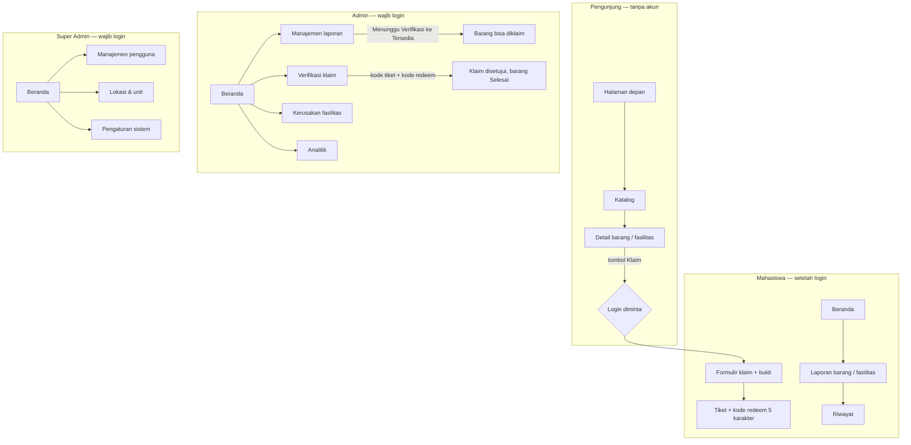

# TITIPIN — Campus Care (PHP Native)

Aplikasi informasi kehilangan/penemuan barang dan pelaporan kerusakan fasilitas kampus.
Versi ini menggabungkan antarmuka lama (HTML + JS) dengan backend API lama
menjadi **satu aplikasi PHP native tanpa framework dan tanpa Composer**.

## Akses tanpa akun

| Halaman | Bisa dibuka pengunjung | Catatan |
|---|---|---|
| `/` (halaman depan) | ya | ringkasan + barang temuan terbaru |
| `/katalog` | ya | cari & filter barang hilang/temuan dan kerusakan fasilitas |
| `/laporan/barang/{id}` | ya | detail barang; nama pelapor disembunyikan |
| `/laporan/fasilitas/{id}` | ya | detail kerusakan; nama pelapor disembunyikan |
| `/klaim/baru/{id}` | **tidak** | butuh login — pintu masuk satu-satunya ke akun |
| `/laporan/baru` (barang & fasilitas) | **tidak** | butuh login |
| `/riwayat`, `/klaim`, `/profil` | **tidak** | butuh login |
| `/admin/*`, `/verifikasi` | **tidak** | butuh login Admin / Super Admin |

**Login hanya diminta ketika pengunjung menekan tombol klaim atau membuat laporan.**
Setelah berhasil masuk, pengguna otomatis dikembalikan ke halaman yang tadi ingin
dibuka (misalnya formulir klaim barang tersebut), bukan dilempar ke beranda.

Admin dan Super Admin selalu harus login lebih dulu — tidak ada halaman admin yang
bisa diakses tanpa sesi.


---

## 1. Menjalankan

> Panduan lengkap pemakaian dan penjelasan setiap berkas ada di **[`TUTORIAL.md`](TUTORIAL.md)**.

1. Pastikan PostgreSQL hidup dan database `titipin` ada.
2. Isi kredensial di `.env` (sudah terisi untuk lingkungan lokal).
3. Jalankan migrasi sekali (aman diulang):

```bash
psql -U postgres -d titipin -f database/2026-11-19_integrasi.sql
psql -U postgres -d titipin -f database/seed_akun.sql
```

4. Buka salah satu URL berikut:

| URL | Keterangan |
|---|---|
| `http://pbl-final-chapter.test/` | vhost Laragon, URL bersih |
| `http://localhost/PBL-FINAL-CHAPTER/public/` | lewat path lokal |

> Document root harus menunjuk ke folder proyek (seperti vhost Laragon yang sudah ada),
> **bukan** ke `public/`, agar `.htaccess` di akar bisa meneruskan request.

### Akun awal

| Email | Password | Peran |
|---|---|---|
| `admin@titipin.ac.id` | `admin123` | Admin |
| `super@titipin.ac.id` | `super123` | Super Admin |
| `mahasiswa@titipin.ac.id` | `mhs12345` | Mahasiswa |

Ganti password ini sebelum dipakai di luar lingkungan latihan.

---

## 2. Struktur

```
index.php              pengalih ke public/ (agar URL akar tetap bisa dibuka)
.htaccess              meneruskan semua request ke public/index.php
.env                   kredensial database (tidak di-commit)
app/
  bootstrap.php        autoloader PSR-4 manual + helper
  helpers.php          env(), config(), e(), url(), csrf_field(), tanggal_id(), dll.
  Core/                App, Router, Request, Response, Session, Auth, View, Validator,
                       Database, AppException
  Middleware/          AuthMiddleware, RoleMiddleware
  Controllers/         Auth, Dashboard, Katalog, Laporan, Barang, Fasilitas,
                       Klaim, Verifikasi, Profil, Controller
  Controllers/Admin/   BarangAdmin, FasilitasAdmin, KlaimAdmin, User,
                       Lokasi, Analitik, Pengaturan
  Models/              Model (basis), User, Barang, Fasilitas, Klaim,
                       Kategori, Lokasi, Pengaturan
  Services/            ClaimService, UploadService, StatistikService,
                       NotifikasiService
config/app.php         menu per peran, aturan redeem, batas upload, label enum
routes/web.php         tabel rute + middleware
views/                 layouts/, partials/, auth/, dashboard/, beranda/, laporan/,
                       barang/, fasilitas/, katalog/, klaim/, verifikasi/,
                       profil/, admin/, errors/
public/                satu-satunya folder yang boleh diakses browser
  index.php            front controller
  .htaccess            rewrite ke index.php
  assets/css/style.css stylesheet aplikasi (gabungan CSS lama + kelas baru)
  assets/js/app.js     toggle password, pratinjau foto, sidebar, popup detail,
                       filter lantai → ruangan, panel notifikasi
  uploads/             berkas unggahan + .htaccess pengaman
database/
  schema.sql                     skema penuh untuk database kosong
  2026-11-19_integrasi.sql       migrasi untuk database yang sudah ada
  seed_akun.sql                  akun Admin, Super Admin, Mahasiswa
```

> Folder `legacy/` (frontend lama) dan `TitipinBe/` (backend API lama) sudah
> **dihapus**. Keduanya tidak lagi dipakai: seluruh logika sudah pindah ke
> `app/`, dan seluruh tampilan sudah menjadi view PHP. Riwayatnya tetap ada
> di commit Git sebelumnya bila suatu saat perlu dirujuk.

---

## 3. Alur per peran

### Satu formulir untuk tiga jenis laporan

`/laporan/baru` melayani **barang hilang**, **barang temuan**, dan **kerusakan
fasilitas**. Jenis yang dipilih menentukan tabel tujuan (`barang` atau
`kerusakan_fasilitas`), sehingga pengguna tidak perlu berpindah halaman.
Label "Nama barang" berubah menjadi "Nama fasilitas" saat jenis kerusakan dipilih.
`/laporan/baru?jenis=Rusak` langsung membuka formulir kerusakan.

Lokasi dipilih bertingkat: **lantai** lebih dulu (`Lantai 5 Barat`, `Lantai 6
Timur`, `Lantai 6 Barat`, `Lantai 7 Timur`, `Lantai 7 Barat`, `Lantai 8 Timur`,
`Lantai 8 Barat`), lalu **ruangan** pada lantai tersebut.

Dropdown ruangan selalu aktif: sebelum lantai dipilih, seluruh ruangan
ditampilkan; setelah lantai dipilih, daftarnya disaring dan nilai ruangan
yang tidak lagi cocok dikosongkan. Saat ini setiap lantai berisi
**Ruangan 1–8** (nama sementara, bisa diganti di `/admin/lokasi`).

### Kode redeem hanya untuk klaim barang

| Kejadian | Kode redeem | Yang mengubah status |
|---|---|---|
| Klaim barang temuan | **ya** — 5 karakter, berlaku 24 jam | admin lewat `/verifikasi` |
| Laporan kerusakan fasilitas | **tidak** | admin lewat `/admin/fasilitas` (Dilaporkan → Proses Perbaikan → Selesai + catatan teknisi) |
| Verifikasi laporan barang | tidak | admin lewat `/admin/barang` (Menunggu Verifikasi → Tersedia) |

### Notifikasi

Lonceng di topbar membuka panel notifikasi (bukan tautan ke halaman klaim).
Isinya dihitung dari keadaan data saat ini, sehingga tidak ada penghitung yang
bisa tertinggal:

| Peran | Isi notifikasi |
|---|---|
| Mahasiswa | klaim disetujui / ditolak / menunggu verifikasi, laporan diverifikasi, laporan selesai |
| Admin & Super Admin | laporan barang menunggu verifikasi, klaim menunggu verifikasi, laporan kerusakan baru, perbaikan berjalan |

### Popup detail

Tombol **Detail** pada kartu barang membuka popup berisi foto, kode, jenis,
status, lokasi, deskripsi, dan nama pelapor (hanya untuk pengguna yang masuk).
Payload dititipkan pada atribut `data-detail`; tautan halaman detail tetap ada
sebagai cadangan bila JavaScript dimatikan. Popup ditutup dengan tombol ✕,
klik latar, atau tombol `Esc`.



### Aturan klaim (dijaga di `app/Services/ClaimService.php`)

- Hanya barang `Found` dengan status `Tersedia` yang bisa diklaim.
- Pelapor tidak boleh mengklaim barangnya sendiri.
- Bukti kepemilikan **wajib** (maks 5 MB, JPG/PNG).
- Satu pengguna satu klaim aktif per barang (dijaga juga oleh *partial unique index*).
- Kode redeem 5 karakter di-`password_hash`, hanya ditampilkan **sekali**, berlaku 24 jam.
- Klaim yang lewat 24 jam otomatis `Ditolak` (lazy expiry di setiap request klaim).
- Persetujuan hanya lewat kode redeem; setelah disetujui barang jadi `Selesai` dan
  klaim pending lain pada barang itu otomatis ditolak.
- Admin **tidak** bisa menandai barang temuan `Selesai` secara manual — status itu
  hanya lahir dari redeem.

---

## 4. Keputusan yang diambil

| Topik | Keputusan | Alasan |
|---|---|---|
| Framework | PHP native + MVC manual | sesuai permintaan; tanpa Composer |
| Frontend | Server-rendered (view PHP) | menghapus seluruh XSS berbasis `innerHTML` |
| Router | satu front controller `public/index.php` | hanya satu berkas yang bisa diakses langsung |
| Enum status | tetap 3 nilai DB | `Prioritas` jadi kolom `boolean`, `Diproses` dipetakan ke `Diajukan` |
| Jenis laporan | satu formulir untuk 3 jenis | pengguna tidak perlu berpindah halaman; tabel tujuan dipilih otomatis |
| Lokasi | dropdown bertingkat: lantai → ruangan | `lokasi.gedung` menyimpan lantai; baris lama dinonaktifkan (`aktif = false`) agar riwayat tetap utuh |
| Jam kejadian | kolom `waktu_kejadian` (teks pilihan) | mengikuti dropdown lama, tanpa parsing tanggal |
| Detail lokasi | kolom `lokasi_detail` | mempertahankan field "detail lokasi spesifik" |
| Super Admin | nilai enum baru | menu manajemen pengguna/lokasi/pengaturan hanya untuknya |
| Hapus user | tetap `ON DELETE CASCADE` | belum diubah; lihat bagian 7 |
| CSV | `fputcsv` + escape formula | mencegah CSV injection |

---

## 5. Keamanan

| Aspek | Implementasi |
|---|---|
| SQL injection | seluruh query memakai prepared statement + parameter terikat |
| XSS | semua output lewat `e()` (`htmlspecialchars`), tidak ada `innerHTML` |
| CSRF | token per sesi, diperiksa router untuk **semua** POST |
| Session fixation | `session_regenerate_id(true)` saat login dan logout |
| Cookie | `HttpOnly`, `SameSite=Lax`; "Ingat saya" memperpanjang 30 hari |
| Password | `password_hash` / `password_verify` (bcrypt) |
| Otorisasi | middleware `auth` dan `role:...` per rute; klaim hanya bisa dilihat pemiliknya |
| Unggah berkas | whitelist ekstensi **dan** MIME (`finfo`), batas ukuran, nama file acak |
| Eksekusi berkas unggahan | `RemoveHandler` + `Options -ExecCGI` (bukan `php_flag engine off`) |
| Error database | pesan asli hanya ke `error_log`, klien menerima pesan umum |
| Status HTTP | 404, 302, 403/redirect sesuai konteks |

---

## 6. Perbedaan dengan versi lama

| Versi lama | Sekarang |
|---|---|
| `index.html` + `pages/*.html` + 8 berkas JS | view PHP, satu halaman per rute |
| data di `localStorage` | PostgreSQL |
| login demo tanpa password | `password_verify` |
| tombol role tanpa penjagaan | middleware peran di setiap rute |
| `api/*.php` 24 berkas | controller + service; folder lama sudah dihapus |
| `php_flag engine off` (membuat folder 500) | `RemoveHandler` |
| 2 CSS berbeda (`style.css` vs `assets/css/style.css`) | satu `public/assets/css/style.css` |
| tidak ada skema DB | `database/schema.sql` + migrasi idempoten |

---

## 7. Catatan lanjutan (belum dikerjakan)

1. **Hapus user masih `ON DELETE CASCADE`** — menghapus akun ikut menghapus laporan dan
   klaimnya. Ganti ke `SET NULL` bila riwayat harus dipertahankan.
2. **Belum ada rate limit** pada `POST /login` dan percobaan kode redeem.
   Kode 5 karakter dari 32 alfabet ≈ 33 juta kombinasi; TTL 24 jam sudah membatasi,
   tetapi pembatasan percobaan per tiket tetap disarankan.
3. **Belum ada halaman ekspor untuk fasilitas** (barang sudah ada).
4. **Belum ada notifikasi email** — kolom `notifikasi_email` di Pengaturan baru tersimpan.
5. **Retensi laporan** (`retensi_hari`) baru tersimpan, belum ada pembersihan otomatis.
6. **Belum ada pembatasan jumlah klaim** per pengguna di luar aturan satu-klaim-per-barang.
